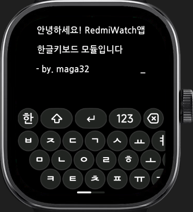

# 레드미워치 앱용 한글 키보드 모듈


## 적용 방법

### 1. 다운로드

```
git clone https://github.com/maga32/RedMiWatch6-KorKeyboard.git
```

### 2. 적용

 - 프로젝트의 components 폴더를 해당 컴포넌트를 사용하려는 프로젝트의 src 디렉터리로 복사하세요.
 - 해당 프로젝트는 es-hangul에 의존합니다. es-hangul 라이브러리를 설치해주세요.
```
npm install es-hangul
```
 - /src/manifest.json 의 "features" 에 해당 기능 추가가 필요합니다.
```
"features": [
    {"name": "system.vibrator"},
    {"name": "system.device"},
    {"name": "system.storage"}
],
```

### 3. 배포시 주의점 (폰트관련)
 - 개발을 위해 기본적으로 /src/components/InputMethod/assets/NanumGothicLight.otf 파일이 포함되어있습니다.
 - 해당 폰트 파일은 315kb 용량이지만 경량버전으로, 내장 폰트와 달리 '뷁' 등의 글자를 출력할 수 없습니다.
 - 배포용 빌드시엔 otf 파일삭제 및 css의 @font-face 주석처리 하여 내장폰트를 사용하는것을 추천드립니다.
 - 한글 내장폰트가 없는 워치의 경우 해당폰트나, 원하는 폰트를 대체하여 사용하셔도 괜찮습니다.


## 적용 예제 코드
 - [Sample link](./src/pages/index/index.ux)

## Resources
- [Vela Keyboard Reference](https://github.com/NEORUAA/Vela_input_method)
- [es-hangul](https://github.com/toss/es-hangul)
- [Nanum Gothic Light font](https://hangeul.naver.com/font)